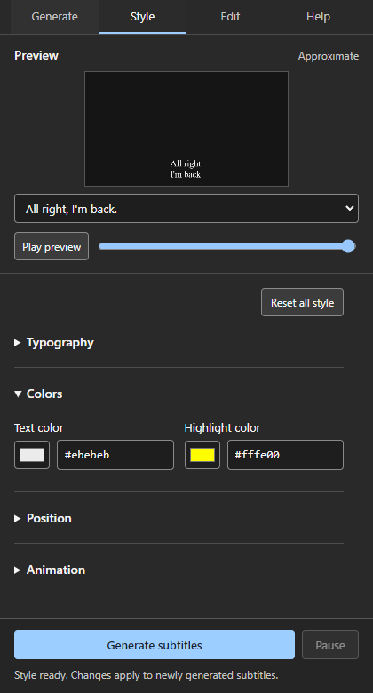

# Subtitle Generator

Turn a Premiere transcript into editable, word-timed subtitle graphics on your timeline. Words appear as you speak, with optional highlighting of the current word.

**Windows · Tested on Premiere Pro 26.2.2 · Local development build**

[Get started](#get-started) · [Everyday workflow](#everyday-workflow) · [Compatibility](#compatibility) · [Limits](#limits)

<p align="center">
  
</p>

*Actual CEP panel. The preview is approximate; Premiere's rendered graphics are the final reference.*

## From transcript to timeline

1. **Transcribe in Premiere.** The extension reads the active sequence automatically. Captions, SRT and manual JSON export are not required; a JSON chooser remains available as a fallback.
2. **Group and style.** Choose characters per phrase, one or two lines, or one word at a time. Preview fonts, colors, position, alignment and word reveal before generating.
3. **Generate and edit.** Create independent MOGRT word graphics directly in the current sequence. Adjust their timing on the timeline, update a phrase's text, or sync selected graphics to a parent style.

Earlier words remain visible as a phrase grows. **Default** alignment reserves the completed phrase's centered block: Left builds rightward from a fixed edge, Right grows leftward in spoken order, and Center keeps recentering.

## Get started

The current installer targets the tested Windows setup. It requires a separately installed compatible landscape subtitle MOGRT and the Premiere 2026 sequence preset at the paths in [install-dev.ps1](prototype/cep/install-dev.ps1). The template is not included in this repository; an arbitrary MOGRT is not a drop-in replacement.

From the repository root in PowerShell:

```powershell
./prototype/cep/install-dev.ps1 -InstallReader
```

Adobe Creative Cloud Desktop's plugin installer is needed for the background reader. Node.js is optional for installation, but enables scanning your installed fonts; without it, standard font choices remain.

Save your project and restart Premiere once after installation. Then open **Window → Extensions → Subtitle Generator**. The installed transcript reader starts with Premiere; you do not need to open UXP Developer Tools for everyday use.

For later panel-only updates, run the installer without `-InstallReader`, then reopen Premiere. Installation details and uninstall instructions are in the [panel guide](prototype/cep/README.md).

## Everyday workflow

Open the extension whenever you work in Premiere. A new project does not need a graphic or MOGRT already on its timeline; the installed template supplies the graphics.

| Tab | What you do |
| --- | --- |
| **Generate** | Read or refresh the transcript, set phrase length and line count, inspect the first phrases. |
| **Style** | Preview appearance; expand Typography, Colors, Position or Animation as needed. Drag numeric values or click to type. |
| **Edit** | Set a generated graphic under the playhead as parent, sync selected graphics, or read and update a phrase. |
| **Help** | Expand task-based instructions and troubleshooting. |

Add an **empty top video track** before generating. Output goes into the active sequence, without making a duplicate sequence.

Settings and transcript snapshots are remembered per project and sequence. Automatic transcripts refresh before generation; use **Refresh** after corrections. A manual JSON choice stays manual until you refresh from Premiere.

**Ctrl+Z** and **Ctrl+Shift+Z** undo and redo panel settings. While typing, fields retain normal text undo. Panel history lasts while the panel is open; timeline operations use Premiere's own undo.

## Compatibility

| Environment | Status |
| --- | --- |
| **Premiere Pro 26.2.2 on Windows** | Tested locally, including editable output and rendered-frame checks. |
| Other eligible 26.x builds | Untested. The combined manifest range is **26.2.2 up to, but excluding, 27.0**. Loading eligibility is not verified compatibility. |
| Premiere 27.x, older releases, macOS | Not supported by the current installer/manifests or not tested. |

There is no exact-version lock to 26.2.2. It is the only tested build. Keep using the installed setup; check a short sequence before adopting a Premiere update. The installer also contains Windows and Premiere-2026-specific paths, so a wider manifest alone would not make another setup supported.

See the [compatibility record](docs/premiere-compatibility.md) for the evidence and remaining checks.

## Limits

- **Parent Sync copies static template style.** It preserves destination text and timing and only changes selected graphics. Added effects such as S_Shake, Motion, Transform and Drop Shadow are not copied; existing destination effects remain. Keyframed template style controls block Sync. Use Premiere's Paste Attributes for separate effects.
- **Resume lasts for the open panel.** Pause finishes the current batch; switching sequences also pauses. Return to the original sequence and resume before moving its generated subtitle clips. Closing the panel or Premiere loses continuation; completed graphics remain.
- **Phrase corrections retain clip boundaries.** Read a selected generated phrase, edit its text, then update. Duplicate or delete word graphics first if changing the word count.
- **The template and preview have defined scope.** The tested template is landscape; portrait layouts and arbitrary MOGRTs are unverified. Local-font measurements can differ slightly from Premiere. There is no text-shadow toggle or automatic per-word pop.

This is usable on the tested setup, with a template dependency and development installer. Broader distribution still needs portable installation and more host testing.

## Verification and development

Node.js 20 or later; no package installation required:

```powershell
npm test
```

**104 tests pass** across parsing, grouping, sequence identity, generation guards, pause/resume, phrase updates, parent style copying and panel behavior. Live checks also cover rendered alignment and two-line reveal, keyboard undo, pinned preview, 64 layout combinations and automated accessibility audits. These checks do not establish cross-version compatibility or screen-reader support.

- [Workflow and native verification](docs/transcript-generator.md)
- [UI review and current findings](docs/ui-polish-review.md)
- [Compatibility record](docs/premiere-compatibility.md)
- [Reader diagnostics](prototype/README.md)
