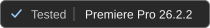
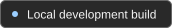

<p align="center">
  
</p>

<h1 align="center">Subtitle Generator</h1>

<p align="center">
  <strong>Your transcript. Your style. Editable on the timeline.</strong><br>
  Word-timed subtitle graphics for Premiere Pro, with reveal and optional highlighting.
</p>

<p align="center">
  <a href="#compatibility"></a>
  <a href="#compatibility"></a>
  <a href="#get-started"></a>
</p>

<p align="center">
  <a href="#get-started"><strong>🚀&nbsp;Get&nbsp;started</strong></a> &nbsp;·&nbsp;
  <a href="#everyday-workflow"><strong>🎛️&nbsp;Workflow</strong></a> &nbsp;·&nbsp;
  <a href="#compatibility"><strong>🧩&nbsp;Compatibility</strong></a> &nbsp;·&nbsp;
  <a href="#limits"><strong>📌&nbsp;Limits</strong></a>
</p>

---

<p align="center">
  
</p>

<p align="center"><sub>Actual CEP panel. Approximate preview; Premiere's rendered graphics are the final reference.</sub></p>

## From transcript to timeline

1. **Transcribe in Premiere.** The extension reads the active sequence automatically. Captions, SRT and manual JSON export are not required; a JSON chooser remains available as a fallback.
2. **Group and style.** Choose characters per phrase, one or two lines, or one word at a time. Preview fonts, colors, position, alignment and word reveal before generating.
3. **Generate and edit.** Create independent MOGRT word graphics directly in the current sequence. Adjust their timing on the timeline, update a phrase's text, or sync selected graphics to a parent style.

Earlier words remain visible as a phrase grows. **Default** alignment reserves the completed phrase's centered block: Left builds rightward from a fixed edge, Right grows leftward in spoken order, and Center keeps recentering.

## Get started

The installer supports Windows and requires Premiere plus Adobe Creative Cloud Desktop. A compatible subtitle MOGRT must be supplied separately and kept installed. The template is not bundled. The generator expects a specific set of exposed text and layout controls, so an arbitrary MOGRT is not a drop-in replacement.

Download or clone this repository, extract it to a folder, then double-click **Install.cmd**. The installer detects Premiere and an existing compatible template selection. If either location is missing, a file picker lets you choose it. It checks required template controls before changing the installation.

From PowerShell, you can also run:

```powershell
./Install.ps1
./Install.ps1 -WhatIf
```

`-WhatIf` runs prerequisite checks without installing or changing the registry. Custom locations can be supplied with `-TemplatePath` and `-PremierePath`. Node.js is optional; it enables scanning your installed fonts, while standard choices remain without it.

Save your project and restart Premiere once after installation. Open **Window → Extensions → Subtitle Generator**. The installed transcript reader starts with Premiere; UXP Developer Tools is not needed for everyday use. The selected MOGRT must remain on disk.

For an update, extract the newer files and rerun Install.cmd. The reader installer skips an already-installed matching version. See [installation and uninstall instructions](INSTALL.md), or the [developer panel guide](prototype/cep/README.md).

## Everyday workflow

Open the extension whenever you work in Premiere. A new project does not need a graphic or MOGRT already on its timeline; the installed template supplies the graphics.

| Tab | What you do |
| --- | --- |
| **Generate** | Read or refresh the transcript, set phrase length and line count, inspect the first phrases. |
| **Style** | Preview appearance; expand Typography, Colors, Position or Animation as needed. Drag numeric values or click to type. |
| **Edit** | Set a generated graphic under the playhead as parent, sync selected graphics, or read and update a phrase. |
| **Help** | Expand task-based instructions and troubleshooting. |

Add an **empty top video track** before generating. Output goes into the active sequence, without making a duplicate sequence.

Settings and transcript snapshots are remembered per project and sequence. Automatic transcripts refresh before generation; use **Refresh** after corrections. A manual JSON choice stays manual until you refresh from Premiere.

**Ctrl+Z** and **Ctrl+Shift+Z** undo and redo panel settings. While typing, fields retain normal text undo. Panel history lasts while the panel is open; timeline operations use Premiere's own undo.

## Compatibility

| Environment | Status |
| --- | --- |
| **Premiere Pro 26.2.2 on Windows** | Tested locally, including editable output and rendered-frame checks. |
| Other eligible 26.x builds | Untested. The combined manifest range is **26.2.2 up to, but excluding, 27.0**. Loading eligibility is not verified compatibility. |
| Premiere 27.x, older releases, macOS | Not supported by the current installer/manifests or not tested. |

There is no exact-version lock to 26.2.2. It is the only tested build. Keep using the installed setup; check a short sequence before adopting a Premiere update. The installer detects Premiere's location, but its APIs and the selected template still need testing on each additional build. A wider manifest alone would not establish compatibility.

See the [compatibility record](docs/premiere-compatibility.md) for the evidence and remaining checks.

## Limits

- **Parent Sync copies static template style.** It preserves destination text and timing and only changes selected graphics. Added effects such as S_Shake, Motion, Transform and Drop Shadow are not copied; existing destination effects remain. Keyframed template style controls block Sync. Use Premiere's Paste Attributes for separate effects.
- **Resume lasts for the open panel.** Pause finishes the current batch; switching sequences also pauses. Return to the original sequence and resume before moving its generated subtitle clips. Closing the panel or Premiere loses continuation; completed graphics remain.
- **Phrase corrections retain clip boundaries.** Read a selected generated phrase, edit its text, then update. Duplicate or delete word graphics first if changing the word count.
- **The template and preview have defined scope.** The tested template is landscape; portrait layouts and arbitrary MOGRTs are unverified. Local-font measurements can differ slightly from Premiere. There is no text-shadow toggle or automatic per-word pop.

This is usable on the tested setup, with a template dependency and development installer. A portable Windows installer and a local release builder are included. A self-contained template and more host testing remain necessary for broader support.

## Verification and development

Node.js 20 or later; no package installation required:

```powershell
npm test
```

**105 tests pass** across parsing, grouping, sequence identity, generation guards, pause/resume, phrase updates, parent style copying and panel behavior. Live checks also cover rendered alignment and two-line reveal, keyboard undo, pinned preview, 64 layout combinations and automated accessibility audits. These checks do not establish cross-version compatibility or screen-reader support.

- [Workflow and native verification](docs/transcript-generator.md)
- [UI review and current findings](docs/ui-polish-review.md)
- [Compatibility record](docs/premiere-compatibility.md)
- [Reader diagnostics](prototype/README.md)

## Build a release

```powershell
./scripts/package-release.ps1
```

This builds a versioned Windows ZIP and SHA-256 checksum in `dist/`, using an explicit allowlist of installer, panel and reader files. It includes no MOGRT, font files, user data, local configuration or development debugger. Versioned packages are local build artifacts until published as a GitHub Release. The package's README explains the separate-template requirement.
